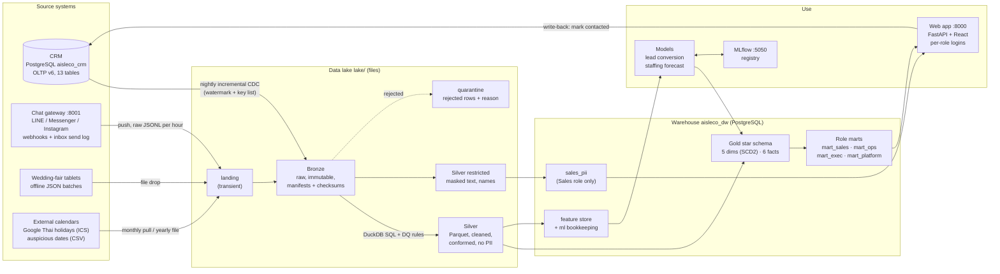
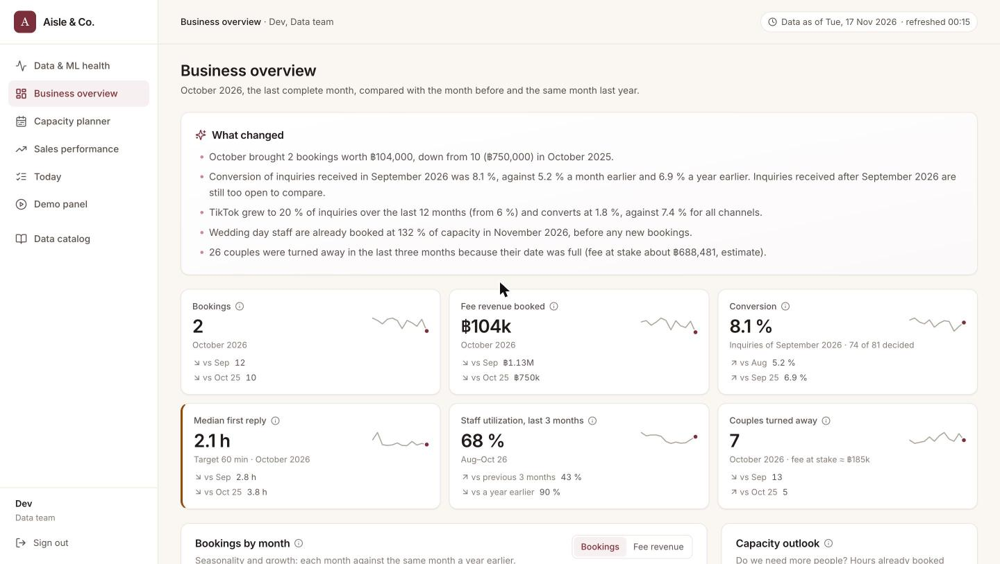
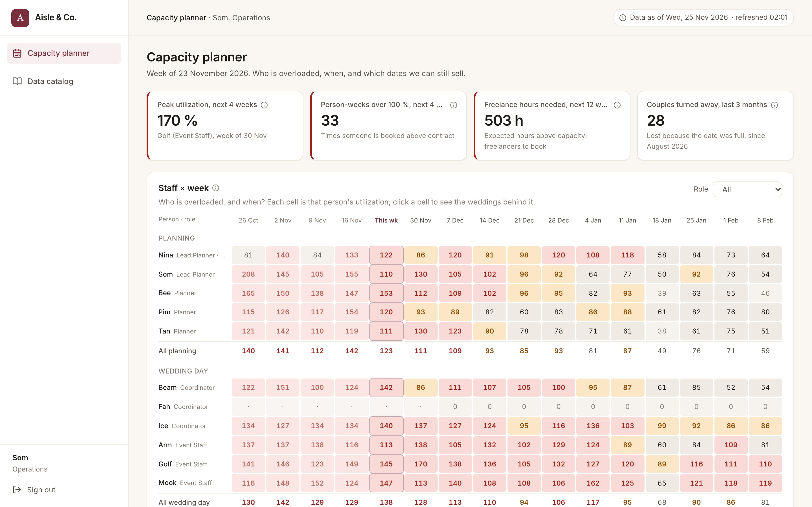
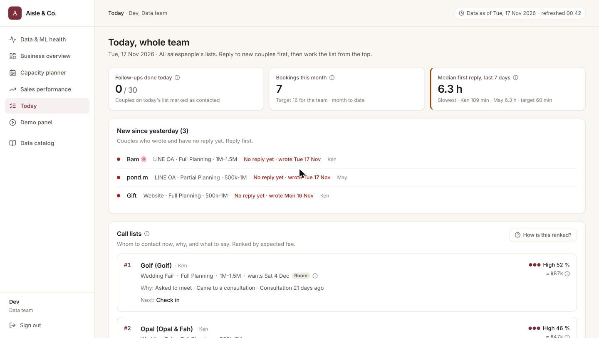
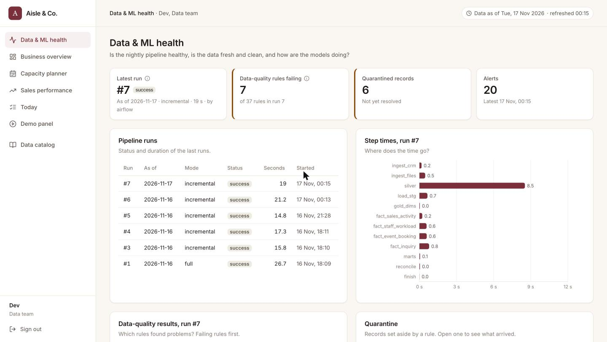

# Aisle & Co. — an end-to-end analytics platform on one MacBook

**MADT 8102 Seminar in Advanced Analytics System Implementation (NIDA) · capstone project · v2, November 2026**

Aisle & Co. is a (fictional) full-service wedding organizer in Bangkok: about 1,500 inquiries a year from LINE,
Facebook, Instagram, TikTok, the website and wedding fairs, about 100 weddings a year, ten planners and crew.
This repository is its complete analytics platform, built and running natively on a single MacBook (no cloud,
no Docker):

- **four source systems**: a CRM database, a chat-webhook gateway, wedding-fair tablets and external calendars;
- **a data lake**: landing, Bronze (raw), Silver (clean) and quarantine zones;
- **a Kimball data warehouse**: star schema with SCD Type 2, and one data mart per business role, locked down with
  PostgreSQL grants;
- **an orchestrated daily pipeline**: Airflow, with data-quality gates, reconciliation, checkpoints and resume;
- **two models with MLOps**: a lead-conversion model that ranks each salesperson's daily call list, and a
  staffing-demand forecast; with a feature store, an MLflow registry, a promotion gate, monitoring and an A/B holdout;
- **a web app with a dashboard per role**: Sales, Operations, Executive and Data team.

All data is produced by a business simulator (`sim/`). It writes only through the doors a real company would use:
rows into the CRM, signed webhooks into the gateway, JSON files into a drop folder. The pipeline cannot tell it
from a real company.

---

## Contents

1. [Results at a glance](#results-at-a-glance)
2. [The business problems](#the-business-problems)
3. [Architecture](#architecture)
4. [Sources and ingestion](#sources-and-ingestion)
5. [Data lake](#data-lake)
6. [Data warehouse and marts](#data-warehouse-and-marts)
7. [Pipeline, orchestration and error handling](#pipeline-orchestration-and-error-handling)
8. [Machine learning and MLOps](#machine-learning-and-mlops)
9. [Dashboards](#dashboards)
10. [Quick start](#quick-start)
11. [Daily operation and command reference](#daily-operation-and-command-reference)
12. [Testing](#testing)
13. [Repository layout](#repository-layout)
14. [Documentation index](#documentation-index)
15. [Course rubric → evidence](#course-rubric--evidence)
16. [Honest notes and limits](#honest-notes-and-limits)

---

## Results at a glance

| Area | Result | Evidence |
|---|---|---|
| Lead-conversion model (v6) | PR-AUC **0.373** vs **0.136** for today's practice (newest message first); gain +0.240, 95 % CI +0.153 to +0.338 | [model card](docs/v2/model_card_lead_conversion.md) |
| Daily call list | a salesperson's top 15 holds **74 %** of the couples who book in the next 60 days, vs **48 %** today | model card |
| Calibration | expected calibration error **0.009** (probabilities can be multiplied by fees) | model card |
| Staffing forecast | error at 5–12 weeks ahead (WAPE) **0.092**, vs 0.124 / 0.249 / 0.337 for three baselines; 80 % band covers 79 % | [PLAN progress log](docs/v2/PLAN.md#13-progress-log) |
| Pipeline correctness | 30 nights replayed incrementally = full reload, **0 differences** over 196,070 rows in 39 tables and views | [e2e_replay.md](docs/v2/e2e_replay.md) |
| Error handling | **10/10** Chapter 6 failure tests pass (CRM down, tampered file, DQ block, crash and resume, batch cap, late commit, hard delete, orphans, …) | [tests/test_error_handling.py](tests/test_error_handling.py) |
| Performance | daily run **≤ 13.3 s** at 10× volume (target 120 s); full initial load 66 s | [benchmark.md](docs/v2/benchmark.md) |
| Real incident | a bad SQL edit was caught by reconciliation rule C01; the scheduled run stopped **before anything was published** | [PLAN progress log](docs/v2/PLAN.md#13-progress-log) |

## The business problems

| # | Problem | Who decides what | What the platform gives them |
|---|---|---|---|
| 1 | **Seasonal demand and capacity.** Weddings bunch up in November–February and on auspicious dates; staff run above 130 % of their contracts in peak weeks and near 40 % in Buddhist Lent; couples asking for a full date are turned away. | Operations: move assignments, book freelancers, stop selling a date. Owner: hire, price peak dates. | A staff × week utilization heatmap with drill-down, a 26-week staff-hours forecast with an uncertainty band, a date checker that offers auspicious alternatives, and couples turned away with the fee at stake. |
| 2 | **High inquiry, low conversion.** About 1,500 inquiries a year, 7–9 % book; sales work newest-first, so a couple who got a quote last week and went quiet is often never called again. | Sales: whom to contact today, why, and what to say. Sales manager: is the list worked, where do couples drop out. | A ranked call list per salesperson: chance to book × expected fee, three plain reasons, a next best action and a "mark contacted" button. Plus funnel, channel conversion with intervals, reply-speed and lost-reason analysis. |

The two problems meet in one place. A couple who asks for a fully booked peak date is a sale lost to capacity, so the
Sales list shows each requested date's capacity badge, and the Operations forecast counts the hours of open leads.

## Architecture



| Zone | Where | Format | Who can read it |
|---|---|---|---|
| Landing | `lake/landing/` | as sent | pipeline only |
| Bronze | `lake/bronze/<source>/…/<received date>/` | as received + manifest (rows, SHA-256) | data team; chat text only by the restricted ML job |
| Silver | `lake/silver/<table>/data.parquet` (+ `silver_restricted/`) | Parquet (ZSTD), rebuilt from Bronze each run, swapped in atomically | data team, ML |
| Quarantine | `lake/quarantine/run=N/` + index `etl.rejected_row` | JSONL with rule and reason | data team |
| Gold | `aisleco_dw.gold` | star schema | data team, marts |
| Marts | `aisleco_dw.mart_*` | views per role | only the matching database role |

Orchestration is Airflow 2.10. `aisleco_daily` runs at 02:00 and does pipeline → scoring → monitoring → forecast;
`aisleco_weekly_train` retrains on Sundays. Governance lives in the `etl` schema (run log, step checkpoints, watermarks,
file checkpoints, 39 data-quality rules and their results, alerts) and in the [data catalog](docs/v2/catalog.html).

## Sources and ingestion

| Source | Rubric type | Format | Ingestion method | Why this method |
|---|---|---|---|---|
| CRM (bookings, chat metadata, staff contracts, follow-ups) | structured | PostgreSQL tables | **incremental change capture** on `UpdatedAt` (trigger-maintained), 5-minute late-commit overlap, one shared snapshot across parallel readers, a primary-key list for deletes, a batch cap with an overflow queue; small master tables as full snapshots; personal data to a restricted folder | reads only changes; the decisions are daily, so log-based CDC (Debezium/Kafka) would be overkill (documented upgrade path) |
| Chat gateway (LINE Messaging API, Meta Messenger/Instagram, shared-inbox log) | semi-structured JSON with **unstructured** Thai/English text | the platforms' real webhook formats, signed (HMAC-SHA256) | **push**: signature verified, raw body appended to an hourly JSONL file, 200 OK in < 100 ms; re-deliveries kept raw, removed in Silver | event-driven source; the platforms retry, so duplicates are expected |
| Wedding-fair tablets | semi-structured (nested JSON, free text) | batch files | **file drop** on reconnect; checksum, duplicate batches flagged | offline devices |
| External calendars | external | Google's public Thai holiday calendar (ICS, real download); auspicious-date CSV | **API pull** monthly; **yearly file** | provider controls the data; last good copy kept on failure |

Payload examples, the method comparison and the personal-data rules are in
[Spec 01](docs/v2/01_sources_and_ingestion.md).

## Data lake

Silver has 11 trusted tables (`calendar_day`, `channel`, `package`, `employee_contract`, `chat_message`, `fair_lead`,
`inquiry`, `event`, `assignment`, `sales_activity`, `auspicious_date`) and 2 restricted ones (`lead_text` with
phone numbers, e-mails and LINE IDs masked; `customer_contact`). One DuckDB SQL file per table
(`pipeline/silver/sql/`) does the work:

- **De-duplication:** re-delivered webhooks are dropped.
- **Times:** UTC epoch milliseconds become Bangkok local time.
- **Conformance:** tracking codes are parsed and free-text budgets ("6 แสน", "around 600k") are mapped to bands.
- **Derived per row:** first-reply time is measured, and an intent tagger turns chat text into 11 transparent
  flags (asked the price, asked if a date is free, price objection, …).
- **Buddhist Lent:** derived from the real Asalha Bucha dates in the holiday feed.

**39 data-quality rules are data, not code** (`pipeline/quality/rules.yml` → `etl.dq_rule`). Each has a severity:
reject (to quarantine), warn, info or block (the run stops before anything is published). The simulator injects
known problems on purpose, and each is caught: 58 malformed bodies (R20), 777 re-deliveries (R22), a truncated
tablet file (R30), an invalid auspicious level (R41), a webhook schema change from 1 Sep 2026 (S05), orphan
assignments (R10b), and others. See [Spec 02](docs/v2/02_data_lake.md).

## Data warehouse and marts

The **Gold star schema** (`pipeline/warehouse/sql/gold_schema.sql`) has 5 dimensions and 6 facts.

Dimensions:
- `DimDate`: day grain, with high season, Buddhist Lent, holidays and auspicious level; role-played 13 ways.
- `DimEmployee`: **SCD Type 2**, one row per contract version, so a past week uses the hours that applied then.
- `DimPackage`, `DimChannel`.
- `DimInquiryOutcome`: a junk dimension.

Facts:
- `FactInquiry`: accumulating snapshot.
- `FactEventBooking`.
- `FactStaffWorkload`: employee × wedding × week, with planning hours spread by an agreed profile.
- `FactSalesActivity`.
- `FactLeadScore` and `FactDemandForecast`: the models' outputs as facts.

Ratios are never stored. Marts divide parts, always as ratios of sums.

**Marts are schemas in the warehouse, one per role**, and the access rules are enforced by PostgreSQL, not only by the
app:

| Mart | Read by | Examples |
|---|---|---|
| `mart_sales` (+ `sales_pii`) | `aisleco_sales` | today's ranked list with date badge, funnel, conversion by channel with Wilson intervals, reply speed, lost reasons, quote share, A/B result |
| `mart_ops` | `aisleco_ops` | staff × week capacity grid, week detail, forward demand, date check, peak acceptance, turned away, hours per wedding |
| `mart_exec` | `aisleco_exec` | monthly KPIs vs previous month and last year, channel mix, capacity outlook, lost value, model value |
| `mart_platform` | `aisleco_data` | runs, step times, DQ results, quarantine, freshness, alerts, model runs, monitoring |

Every KPI formula is in [Spec 03 §6](docs/v2/03_warehouse_and_marts.md). The [data catalog page](docs/v2/catalog.html)
documents 97 tables and 42 KPIs. It traces any KPI tile back through mart, Gold, Silver and Bronze to the CRM column.

## Pipeline, orchestration and error handling

```
ingest_crm ──┐                                        ┌► fact_inquiry ────────┐
             ├► silver ► load_stg ► gold_dims ────────┼► fact_event_booking ──┼► marts ► reconcile ► finish ► ml_score ┬► ml_monitor
ingest_files ┘                                        ├► fact_staff_workload ─┤                                        └► ml_forecast
                                                      └► fact_sales_activity ─┘
```

- Each step runs in its own transaction and records itself in `etl.step_run`.
- `python -m pipeline resume RUN_ID` continues from the failed step.
- Re-running a day changes nothing (idempotent).
- A run cannot go back in time (an as-of guard).
- Watermarks move only after the whole run succeeds.
- Gold facts are merged with change detection, so surrogate keys stay stable.
- Reconciliation checks: Bronze = Silver (C01); Silver = Gold (C02); hours conserved when spread over weeks (C03);
  marts = Gold (C05).
- Airflow adds the schedule, retries with back-off, failure alerts and the UI.

## Machine learning and MLOps

### Lead conversion: "whom does each salesperson contact today?"

| Item | Design |
|---|---|
| Unit | an open inquiry on a score date; features as of 00:00, point in time (a test proves features are identical with or without later data) |
| Label | the couple books within **60 days**. The window was chosen by a rule fixed in advance: the smallest of 30/45/60 days holding ≥ 80 % of bookings; the measured shares were 55 / 72 / 82 % ([EDA](docs/v2/ml_eda.md)) |
| Features | 49 in 6 groups: profile, engagement, stage, chat intents (from the unstructured text), sales activity, capacity of the requested week. Defined once in SQL (`ml/sql/lead_features.sql`) for training and scoring; registry in `feature.registry` |
| Validation | 6-month out-of-time test with a 60-day purge; 5-fold rolling-origin CV for tuning (Optuna, 30 trials), model choice (LightGBM vs logistic regression, ties to the simpler) and feature-group ablation; isotonic calibration; cluster-bootstrap confidence intervals |
| Gate | must beat today's practice (lower 95 % bound > 0), must not be worse than the best simple rule by more than 0.05, ECE ≤ 0.05, no slice much worse than today, not worse than the current champion on data it never saw |
| Serving | daily batch scoring into `gold.FactLeadScore`: probability, expected fee, rank per salesperson, band, three SHAP-based reasons in plain words, next best action |
| Monitoring | PSI per feature and on scores, missing-value shares, out-of-range values, matured-label performance overall and on the holdout; alerts to `etl.alert` |
| A/B | 10 % random holdout of inquiries is worked newest-first (today's practice), so the list's effect is measured, not assumed |

**Gate history: what happened to each candidate** (MLflow registry, `ml.model_run`):

| Version | Result | Why |
|---|---|---|
| v1–v3 | rejected | v1 was compared with itself (fixed); v2 and v3 could not be decided on a 3-month test with ~70 bookers (test extended to 6 months) |
| v4 | champion, then **retired** | a data bug was found later: two budget bands were mis-normalised, so 1,549 high-budget couples had no budget. Fixed in Silver, a regression test was added, and v4 was withdrawn with the reason recorded (`python -m ml retire`) |
| v5 | rejected | the scheduled weekly run, which correctly kept the champion |
| v6 | **champion** | trained on the corrected data and gated on baselines only |

v6 on the test period (23,293 daily rows):

| Score | PR-AUC | ROC-AUC | Precision, daily top 5 | Bookings caught in daily top 15 |
|---|---|---|---|---|
| **Model v6** | **0.373** (CI 0.261–0.496) | 0.866 | 39 % | 74 % |
| Stage rule (B1) | 0.309 | 0.816 | 33 % | 67 % |
| Channel × stage rate (B2) | 0.239 | 0.801 | 32 % | 64 % |
| Today's practice, newest first (B0) | 0.136 | 0.712 | 17 % | 48 % |
| Logistic regression (B3) | 0.395 | 0.870 | 40 % | 74 % |

Logistic regression scores slightly higher on the test than the LightGBM chosen on cross-validation. Switching now
would mean choosing by the test, and the gap is inside the confidence interval, so the model card says so openly.
The chat-text intents add +0.074 PR-AUC in the CV ablation. A data-driven text representation (TF-IDF character
n-grams + SVD) was tested on the same folds and dropped (mean gain −0.001): see
[the text experiment](docs/v2/ml_text_experiment.md).

### Staffing-demand forecast: "will we have enough people in each of the next 26 weeks?"

**Forecast hours = booked + pipeline + pickup**:
- booked: hours of weddings already booked;
- pipeline: open leads × their stage-and-channel booking rate × the average hours profile;
- pickup: bookings not yet in sight, learned by LightGBM quantile regression.

Over 9 monthly origins of backtesting, it beats booked-only, seasonal naive and pickup-ratio baselines. The 80 %
band is calibrated on the backtest (split-conformal), with 79 % leave-one-origin-out coverage. It powers the
Operations page's "next 26 weeks" chart and the freelancer recommendation.

## Dashboards

One web app (FastAPI + React, Vite, TypeScript, Tailwind, Recharts), one login per role. Each page answers the questions
of one role. Every number has a definition tooltip from `catalog/kpis.yml` and a "data as of" stamp.

| Role | Pages | Demo user |
|---|---|---|
| Sales | **Today** (ranked call list with reasons, next action, date badge, "mark contacted" write-back to the CRM), Sales performance, date checker | `may`, `ken`, `nok` (manager) |
| Operations | **Capacity planner** (staff × week heatmap with drill-down, 26-week forecast, date checker with alternatives, turned-away demand) | `som` |
| Executive | **Business overview** (KPIs vs last month and last year, plain-language "what changed", channel mix, capacity outlook, lost value, model value) | `ann` |
| Data team | **Data & ML health** (runs, step times, DQ results, quarantine viewer, freshness, alerts, models), demo panel, catalog | `dev` |

| | |
|---|---|
|  |  |
|  |  |

Why Sales and Operations are separate pages, yet linked, is argued in [Spec 05 §1](docs/v2/05_dashboards.md).

## Quick start

**Prerequisites:**
- macOS (developed on Apple M2, 16 GB) and Homebrew `postgresql@16`.
- Python 3.11, and Node 20+ (for the front-end build).
- Optional, for the scheduler: Airflow 2.10.5 in its own venv (`.venv-airflow`); see
  [archive/v1/README_current_files.md](archive/v1/README_current_files.md) for its macOS fixes.
  `scripts/airflow.sh` applies them.

```bash
brew services start postgresql@16
python3.11 -m venv .venv && .venv/bin/pip install -r requirements.txt

scripts/rebuild.sh          # everything from nothing, about 45 min (model tuning takes most of it):
                            # simulate 2022-07 → yesterday, full pipeline load, train, score, forecast, build the web app
scripts/services.sh start   # gateway :8001 · MLflow :5050 · Airflow :8080 · web app :8000
scripts/services.sh status
```

Open <http://127.0.0.1:8000> and log in with one of the demo users above; the password is `aisleco2026`.

## Daily operation and command reference

Airflow does this every night:
- `aisleco_sim_day` (01:00) simulates yesterday's business. It exists only because the company is simulated.
- `aisleco_daily` (02:00) runs the pipeline and the models.
- `aisleco_weekly_train` (Sunday 03:00) retrains.

The same steps on the command line:

```bash
.venv/bin/python -m sim backfill                         # catch the simulated business up to yesterday
.venv/bin/python -m sim message --text "สนใจ Full Planning ค่ะ"   # a live couple writes now (CRM + signed webhook)
.venv/bin/python -m sim report                           # calibration numbers of the simulation

.venv/bin/python -m pipeline run --asof 2026-11-17 [--full-refresh]
.venv/bin/python -m pipeline resume RUN_ID               # continue a failed run from its checkpoint
.venv/bin/python -m pipeline status

.venv/bin/python -m ml train --asof D                    # tune, calibrate, gate, register in MLflow
.venv/bin/python -m ml daily --asof D                    # score + monitor
.venv/bin/python -m ml forecast --asof D                 # staffing forecast + backtest
.venv/bin/python -m ml card | eda --asof D | text --asof D
.venv/bin/python -m ml rollback | retire --reason "…"

.venv/bin/python scripts/build_catalog.py                # regenerate docs/v2/catalog.html (fails if anything is undocumented)
```

Settings are environment variables with local defaults: `CRM_DSN`, `DW_DSN`, `LAKE_DIR`, `ETL_MAX_ROWS_PER_RUN`
(batch cap), `ETL_OVERLAP_SECONDS`, `GATEWAY_MODE`, `LINE_CHANNEL_SECRET`, `APP_DEMO_PASSWORD`, `APP_SECRET`, … (see
`pipeline/config.py`, `sources/settings.py`, `app/api/`).

## Testing

```bash
.venv/bin/python -m pytest tests -q -m "not slow"   # 84 tests: sources, simulator, Silver, pipeline, ML, app, catalog
.venv/bin/python -m pytest tests -q -m slow         # the 10 Chapter 6 failure tests (own *_e2e* databases)
.venv/bin/python scripts/e2e_replay.py              # 30 nights incremental vs full refresh (~10 min)
.venv/bin/python scripts/benchmark.py               # 1× and 10× volume timings
```

The tests cover:
- **Source-to-target:** CRM counts, fees and hours against the marts.
- **Transformations:** the hours-spread rule, budget bands, SCD2.
- **Leakage:** point-in-time features.
- **Access control:** each database role is refused outside its marts.
- **Idempotency.**
- **The failure scenarios** (`tests/test_error_handling.py`).
- **Catalog completeness.**

## Repository layout

```
sources/crm/            OLTP v6 DDL, triggers, the app's insert-only write-back role
sources/chat_gateway/   FastAPI webhook receiver (signature checks, raw landing)
sources/external/       Thai holiday ICS fetcher (+ cached copy), auspicious-date file
sim/                    the business simulator (couples, staff, platforms, tablets)
pipeline/ingest/        CRM change capture, file ingestion
pipeline/silver/        Bronze → Silver: one DuckDB SQL file per table, intents.yml, runner
pipeline/quality/       data-quality rules (rules.yml) and quarantine
pipeline/warehouse/     Silver → stg → Gold: star schema DDL, one SQL file per table, merge loader
pipeline/marts/         role marts, grants, reconciliation
ml/                     feature store SQL, training + gate, scoring + reasons, monitoring, forecast, EDA, model card
app/api/, app/web/      FastAPI API and React front end
airflow/dags/           aisleco_daily, aisleco_sim_day, aisleco_weekly_train
catalog/                tables.yml, kpis.yml (source of the catalog page and the dashboard tooltips)
scripts/                rebuild.sh, services.sh, airflow.sh, e2e_replay.py, benchmark.py, build_catalog.py
tests/                  pytest suite
docs/v2/                plan, specs, results, catalog page, screenshots, deliverables
archive/v1/             the first version (Streamlit, notebooks), kept for reference
lake/, var/             data and logs created at run time (git-ignored)
```

## Documentation index

| Document | What it covers |
|---|---|
| [docs/v2/PLAN.md](docs/v2/PLAN.md) | the build plan, every design decision with its reason (C1–C26), milestone progress log |
| [Spec 01: sources and ingestion](docs/v2/01_sources_and_ingestion.md) | sources, real payloads, ingestion methods and why |
| [Spec 02: data lake](docs/v2/02_data_lake.md) | zones, layout, every Silver transformation, all DQ rules |
| [Spec 03: warehouse and marts](docs/v2/03_warehouse_and_marts.md) | star schema, SCD2, bus matrix, KPI formulas, marts and grants |
| [Spec 04: machine learning](docs/v2/04_machine_learning.md) | both models: decision, label, features, validation, gate, serving, monitoring |
| [Spec 05: dashboards](docs/v2/05_dashboards.md) | roles, pages, tile-by-tile specification, design rules |
| [Spec 06: simulation](docs/v2/06_simulation.md) | the simulated business, behaviour assumptions, injected data problems, calibration |
| [Data catalog](docs/v2/catalog.html) | every table, column and KPI with formula and lineage (open locally or at `/catalog` in the app) |
| [Model card](docs/v2/model_card_lead_conversion.md), [EDA](docs/v2/ml_eda.md), [text experiment](docs/v2/ml_text_experiment.md) | model evidence |
| [End-to-end replay](docs/v2/e2e_replay.md), [benchmark](docs/v2/benchmark.md) | pipeline evidence |
| [Demo runbook](docs/v2/DEMO_RUNBOOK.md) | minute-by-minute live demo with fallbacks |
| [Slide deck](docs/v2/deliverables/AisleCo_Final_Presentation.pptx), [report Rev 13](docs/v2/deliverables/Wedding_Organizer_Capstone_Rev13.docx) | final presentation and written report |

## Course rubric → evidence

| Dimension | Where to look |
|---|---|
| Data sources | 4 sources covering structured, semi-structured, unstructured and external data, each with its own ingestion method (Spec 01; `sources/`, `pipeline/ingest/`) |
| Database, data lake and warehouse design | OLTP v6 in 3NF; lake zones; Kimball star schema with SCD2 and a bus matrix; marts per role with grants (Specs 02–03; catalog) |
| ETL / data pipeline | daily Airflow pipeline; incremental CDC; DQ with quarantine; reconciliation; resume; replay with 0 differences; failure tests; benchmark |
| Dashboards and visualization | 4 role-based pages, each tile tied to a decision and a defined KPI (Spec 05; `app/`) |
| AI/ML integration | validated, calibrated, gated lead model with business value and A/B design; backtested forecast; MLOps loop (Spec 04; model card) |
| Business problem and storytelling | two problems linked through capacity; recommendations; deck, runbook and report (`docs/v2/deliverables/`) |

## Honest notes and limits

- **The data is simulated.**
  - The behaviour rules (Spec 06) are assumptions, chosen to look like a Bangkok wedding organizer. They were not
    measured from a real company.
  - The hidden "readiness" that drives each simulated couple is never stored where the pipeline or the models
    can see it.
  - What carries over to a real CRM is the platform and the method, not the coefficients.
- **Demo credentials are local defaults only.**
  - `aisleco2026` for the web-app users, and `dev-line-secret` / `dev-meta-secret` / `dev-inbox-key` for the gateway.
  - All are overridable by environment variables. Nothing here should face the internet.
- **Known limits:**
  - The CRM keeps only the latest quote and budget, so edits after a cutoff would leak; a `Quote` table is the fix.
  - Isotonic calibration creates ties in the list; expected fee breaks them.
  - The A/B result needs about 60 days after launch (16 Nov 2026) before the first labels mature.
  - The holiday feed has no lunar holidays after 2027, so Lent is approximated there and flagged.
- **Course material is not part of this repository.** That covers lecture slides and the course outline.

---

*v1 of this project (CRM → warehouse ETL, Streamlit dashboard, notebooks) is preserved in [`archive/v1/`](archive/v1/)
and at [hhej/aisleco-etl-pipeline](https://github.com/hhej/aisleco-etl-pipeline).*
