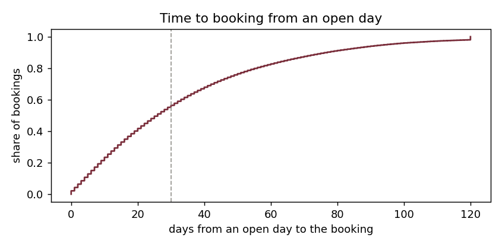
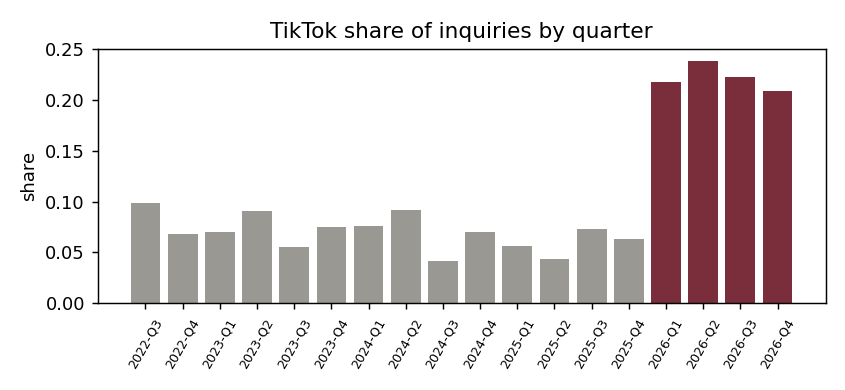

# Lead-conversion model: exploratory analysis (as of 2026-11-17)

Generated by `python -m ml eda`. Data: Silver tables, the same feature definition as training and scoring.

## Rows and labels

- Training spine: 213,322 inquiry-days (each day an inquiry was open, first 60 days), 6,566 inquiries.
- Labels known (window over): 206,626 rows; positive share 6.99% (booked within the label window).

## Why a 30-day label window

Share of bookings that happen within N days of an open day that precedes them:

| Window | Share of bookings |
|---|---|
| 14 days | 29% |
| 30 days | 55% |
| 45 days | 72% |
| 60 days | 82% |

Rule in Spec 04 §2: the label window is the smallest of 30, 45 and 60 days that holds at least 80 % of bookings. Result: **60 days** (the model uses 60).

## Signal by stage and channel (known rows)

| Stage | Booked within the window | Rows |
|---|---|---|
| consulted | 19.4% | 4,895 |
| open | 3.9% | 173,556 |
| quoted | 24.0% | 28,175 |

| Channel | Booked within the window | Rows |
|---|---|---|
| TikTok | 2.4% | 18,424 |
| Walk-in | 2.6% | 3,481 |
| Wedding Fair | 3.7% | 39,200 |
| Website | 6.3% | 11,316 |
| Facebook | 7.4% | 37,889 |
| Instagram | 7.5% | 26,516 |
| LINE OA | 9.4% | 61,114 |
| Referral | 14.2% | 8,686 |

## Missing values (top 8 features)

Missing means 'not reached yet' (no quote, no consultation), not an error; the model gets missing-value indicators, and monitoring watches the missing shares (Spec 04 §9).

| Feature | Missing |
|---|---|
| quoted_amount | 86% |
| quote_share | 86% |
| days_since_quote | 86% |
| days_since_consult | 84% |
| fair_guests | 81% |
| requested_week_utilization | 38% |
| lead_days | 30% |
| requested_high_season | 30% |

## The 2026 shift monitoring must catch

TikTok couples are less ready to book; their share rises in 2026, so the base rate falls (label drift) and the channel mix moves (input drift).
